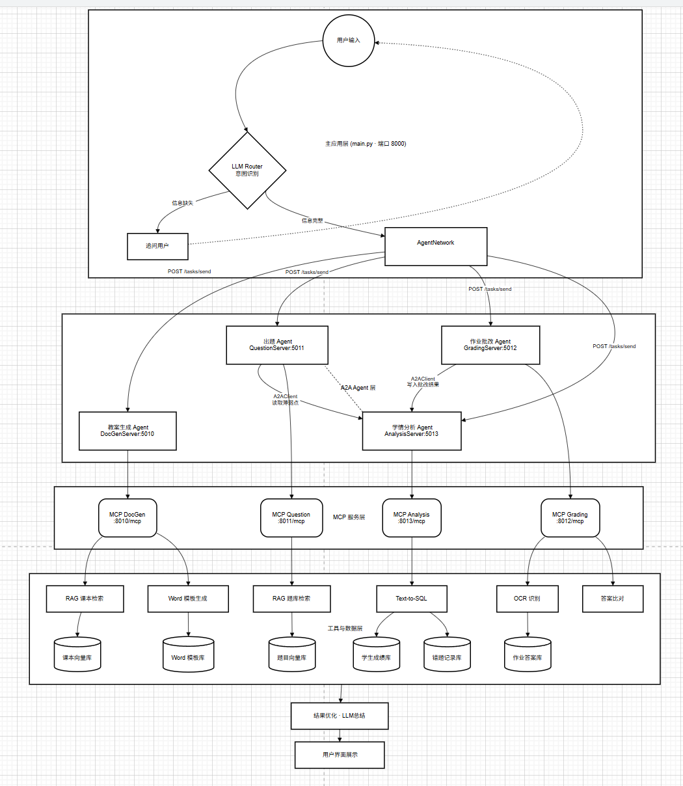

# 智学 · 智慧教学问答与作业批改系统

把原来单进程的 `app.py` 拆成一张真正的多 Agent 架构：
**主应用（LLM Router + AgentNetwork）→ 4 个 A2A Agent → 4 个 MCP Server → 工具与数据层**。

老的 `app.py` / `new_main.py` / `rag_qa` / `mysql_qa` 原样保留，互不影响。

> 新系统全部在 `zhixue/` 目录下，从 [快速开始](#二快速开始) 直接跑。
> 原项目的说明在文末 [附录：原项目](#附录原项目itcast_qa_system)。

## 整体架构



自上而下四层：**主应用**（LLM Router 意图识别 + AgentNetwork 分发）→ **A2A Agent 层**
（教案生成 / 出题 / 批改 / 学情分析）→ **MCP 服务层**（四个 `/mcp` 端点）→
**工具与数据层**（课本向量库、Word 模板库、题目向量库、学生成绩库、错题记录库、作业答案库），
最后由「结果优化 · LLM 总结」汇总回用户界面。

图中两条**虚线**是 Agent 之间的横向协作，也是这套系统"能自己转起来"的关键：

* **批改 → 学情**：批改完成后把错题推给学情分析 Agent 落库（已实现，走真实 A2A 消息）；
* **出题 ← 学情**：出题 Agent 在做"错题巩固"时，向学情 Agent 读取错题记录（已实现）。

---

## 一、架构与代码的对应关系

| 层 | 组件 | 端口 | 代码 |
|---|---|---|---|
| 主应用 | 主应用（LLM Router / AgentNetwork / 结果总结） | **8000** | `zhixue/app/main.py` `router_agent.py` `agent_network.py` `summarizer.py` |
| 主应用 | 课本答疑（RAG） | — | `zhixue/app/qa.py` |
| A2A Agent | 文档生成 Agent | **5010** | `zhixue/agents/docgen_agent.py` |
| A2A Agent | 出题 Agent | **5011** | `zhixue/agents/question_agent.py` |
| A2A Agent | 作业批改 Agent | **5012** | `zhixue/agents/grading_agent.py` |
| A2A Agent | 学情分析 Agent | **5013** | `zhixue/agents/analysis_agent.py` |
| MCP | MCP DocGen | **8010/mcp** | `zhixue/mcp_servers/docgen_mcp.py` |
| MCP | MCP Question | **8011/mcp** | `zhixue/mcp_servers/question_mcp.py` |
| MCP | MCP Grading | **8012/mcp** | `zhixue/mcp_servers/grading_mcp.py` |
| MCP | MCP Analysis | **8013/mcp** | `zhixue/mcp_servers/analysis_mcp.py` |
| 工具与数据 | 课本检索 / Word 模板 | — | `zhixue/tools/docgen_tools.py` `zhixue/vector.py` |
| 工具与数据 | 题库检索 / 组卷 | — | `zhixue/tools/question_tools.py` |
| 工具与数据 | OCR / 答案比对 | — | `zhixue/tools/grading_tools.py` |
| 工具与数据 | Text-to-SQL / 学情 | — | `zhixue/tools/analysis_tools.py` |

---

## 一·五、能力闭环：批改 → 学情 → 出题

四个 Agent 分成两组：**内容生产组**（教案、出题）负责"给东西"，
**数据沉淀组**（批改、学情）负责"记事实"。两组之间有一条闭环：

```
  学生作答
     ↓
  批改 Agent ──→ 分数 + 逐题对错
     │
     └──错题──→ 学情 Agent（错题记录库）
                    │
                    └──错题指针──→ 出题 Agent
                                      │
                          指针换实体（回自己的题库）+ 排除近期已出过的题
                                      ↓
                                   错题巩固作业
                                      ↓
                                  学生再做 → 回到批改
```

**出题 Agent 有两个入口，一条出口**：

| 入口 | 触发方式 | 走向 |
|---|---|---|
| 标签式 | "给 Python 装饰器出 3 道题" | 解析知识点 → 题库检索 → 出题 |
| 样本式 | "把做错的题再出几道" | A2A 找学情要错题**指针** → 回题库换实体 → 出题 |

入口二遵守一条架构规矩：**数据归谁管，就通过谁拿。**
错题记录库归学情 Agent 独占，出题 Agent 不直连；而题库本来就是出题 Agent 的地盘，
所以"指针换实体"这一步是它自己的活。

教案生成 Agent 刻意**不在这条闭环上**——它面向知识不面向人，
输入一个主题、输出一份教案，不参与"做错—记下—再练"的循环。

---

## 一·六、账号、用户隔离与记忆

### 两种身份，分开存放

| | 是什么 | 例子 |
|---|---|---|
| **账号身份** `user_id` | 谁在对话 | `US00001` |
| **数据主体** `student_id` | 对话里谈的是谁的数据 | `S00001` |

学生账号被**强制绑定**到自己的学号，请求里传什么都改不了；
老师账号不绑定，谈谁由对话内容决定。这样以后加老师端不需要重构。

### 隔离落在每一层

| 层 | 隔离方式 |
|---|---|
| 入口 | 身份只从 `Authorization: Bearer <token>` 解析，**不从请求参数取** |
| 会话 | `conversation` 表按 `user_id` 过滤，别人的 `session_id` 读不到内容 |
| 草稿 | 缓存 key 是 `zhixue:draft:{user_id}:{session_id}` |
| 文件 | 生成与上传的文件落在 `data/outputs/{user_id}/`、`data/uploads/{user_id}/` |
| **跨 Agent** | **`user_id` 随 `TaskRequest` 一路传递**，各层不重新解析 |

### 记忆分四层，分别归不同 Agent

| 层 | 记什么 | 存在哪 |
|---|---|---|
| 会话记忆 | 最近聊了什么 | `conversation` 表 |
| 工作态记忆 | 槽位草稿（"还差一个知识点"） | 缓存，按 user + session 隔离 |
| 业务记忆 | 错题、成绩、薄弱点 | 学情 Agent 的错题/成绩库 |
| 交互记忆 | 出过哪些题（**用于防重复**） | `question_history` 表 |

三条硬约定：

1. 身份在入口解析一次，之后随任务包传递；
2. 所有存储访问强制带身份过滤；
3. **身份缺失或非法直接拒绝**——降级可以用于功能，不能用于权限。

> Agent 本身是**无状态**的：记忆是"每次去取"，不是"进程里存"。
> 这样多用户并发不会串，重启也不会丢。

---

## 二、快速开始

### 1. 准备配置

仓库里不含 `config.ini`（里面有 API Key 和数据库密码，已被 `.gitignore` 排除）。
先复制一份出来填自己的值：

```powershell
copy config.example.ini config.ini
```

至少要改这几项：

```ini
[llm]
dashscope_api_key = 你的 DashScope API Key   # 否则模型调用会 401，系统降级为规则输出

[zhixue]
mysql_password = 你的 MySQL 密码
```

### 2. 装依赖

```powershell
pip install -r requirements-zhixue.txt
```

如果你已经装过 `fastmcp`，而 `fastapi` 报
`Router.__init__() got an unexpected keyword argument 'on_startup'`，
说明 starlette 被顶到了 1.x，需要把 fastapi 一起升上去：

```powershell
pip install -U "fastapi>=0.140"
```

### 3. 生成仿真数据

```powershell
python -m zhixue.data.seed --reset
```

会生成：20 名学生、19 个知识点、46 道题、10 份作业、约 166 份提交、
约 397 条批改明细、153 条错题记录，以及 4 套 Word 模板和答题卡图片。

数据落在 MySQL 的 **`zhixue`** 库（不动原来的 `subjects_kg`）。

### 4. 启动

```powershell
python run_all.py                  # 启动全部 9 个进程
python run_all.py --check          # 只做环境自检
python run_all.py --only main      # 只起主应用
python run_all.py --mode local     # 单进程模式（不需要 MCP/A2A SDK）
```

浏览器打开 <http://127.0.0.1:8000>。

### 5. 登录（演示账号）

生成仿真数据时会自动建好账号，默认口令都是 `123456`：

| 账号 | 角色 | 能看到什么 |
|---|---|---|
| `s00001` … `s00020` | 学生 | **只能看到自己**的学情与文件 |
| `teacher` | 老师 | 全部 20 个学生，可指定学号操作 |

登录后所有请求都要带 `Authorization: Bearer <token>`；
不带凭证访问 `/api/chat` 会直接返回 401。

---

## 二·五、模型权重说明（仓库里没有，需要自己放）

仓库只包含代码、文档和少量示例数据。**模型权重约 12 GB，被 `.gitignore` 排除了**
（`*.bin` / `*.safetensors` / `*.pt` / `*.onnx` 等）。

智学本身在**没有这些模型时也能完整跑通**（检索自动降级为 BM25 关键词检索）。
想启用向量检索 / OCR / 意图分类，按下面这张表把权重放回对应目录：

| 目录 | 模型 | 用途 | 没有时的影响 |
|---|---|---|---|
| `rag_qa/models/bge-m3` | [BAAI/bge-m3](https://huggingface.co/BAAI/bge-m3) | 向量化（1024 维） | 检索降级为 BM25 |
| `rag_qa/models/bge-reranker-large` | [BAAI/bge-reranker-large](https://huggingface.co/BAAI/bge-reranker-large) | 重排 | 只影响原项目的 RAG 精排 |
| `rag_qa/models/nlp_bert_document-segmentation-chinese-base` | [damo/nlp_bert_document-segmentation_chinese-base](https://modelscope.cn/models/damo/nlp_bert_document-segmentation_chinese-base) | 长文分段 | 只影响原项目的文档切分 |
| `rag_qa/core/bert_query_classifier` | 本项目自训（`rag_qa/core/train_bert.py`） | 通用/专业二分类 | 只影响原项目的查询分类 |
| `rag_qa\core\output`、`bert_results`、`bert_outputs` | 训练 checkpoint | 训练产物，可删 | 无 |

下载示例（HuggingFace 镜像）：

```powershell
pip install -U "huggingface_hub[cli]"
huggingface-cli download BAAI/bge-m3 --local-dir rag_qa/models/bge-m3
huggingface-cli download BAAI/bge-reranker-large --local-dir rag_qa/models/bge-reranker-large
```

放好之后重建一次向量索引：

```powershell
python -c "from zhixue.vector import get_retriever; print(get_retriever().rebuild())"
```

---

## 三、试着说这几句

| 输入 | 走哪条链路 |
|---|---|
| `给 Python 装饰器出 3 道题` | LLM Router → 出题 Agent → 题库向量库 → 作业下发 |
| `把做错的题再出几道给我练` | 出题 Agent → **A2A 读学情错题** → 回题库换实体 → 错题巩固作业 |
| `批改 S00001 的 HW00001` | 批改 Agent → 复用已有作答重新批改 → **A2A 通知**学情分析落错题 |
| 点「上传答题卡」选 `zhixue/data/outputs/answer_sheet_HW00001_S00001.png`，再发 `批改 S00001 的 HW00001` | 批改 Agent → **OCR 识别** → 比对 → A2A 落错题 |
| `分析一下我的学情`（学生账号） | 学情 Agent → 成绩库 + 错题库 → 学生画像 |
| `分析一下 S00003 的学情`（老师账号） | 同上，可指定任意学号 |
| `生成装饰器的学习计划` | 教案 Agent → 课本检索 → Word 模板渲染 |
| `解释一下 Java 线程池的核心参数` | 主应用 RAG 答疑（带课本引用） |
| `批改作业` → `S00001 和 HW00002` | 信息缺失 → 追问 → 多轮补槽后继续 |

> 种子数据保证 **S00001 交齐了全部作业**，并且 `HW00001~HW00003` 都生成了答题卡图片，
> 所以上面这几句可以直接照着敲。

---

## 四、接口清单（主应用 :8000）

| 方法 | 路径 | 说明 |
|---|---|---|
| POST | `/api/login` | 登录（返回 token，唯一免鉴权接口） |
| GET | `/api/me` | 当前账号信息 |
| POST | `/api/chat` | 对话（返回结构化 JSON + 卡片） |
| POST | `/api/chat/stream` | 对话（SSE：`route` / `agent` / `token` / `card` / `end`） |
| GET | `/api/students` | 学生列表（学生账号只返回自己） |
| GET | `/api/homeworks` | 作业列表 |
| GET | `/api/agents` | 四个 Agent 在线状态 |
| GET | `/api/retrieval` | 向量检索后端状态 |
| GET/DELETE | `/api/session/{id}` | 会话历史 / 清空 |
| POST | `/api/upload` | 上传答题卡图片 |
| GET | `/api/files/{name}` | 下载生成的文档 / 图片 |
| GET | `/health` | 健康检查 |

除 `/api/login`、`/health` 与静态页面外，**所有接口都需要登录**。

每个 Agent（:5010~:5013）都提供：

* `POST /task/send` —— 架构图上的任务入口（接受完整 TaskRequest 或 `{"text": "..."}`）
* `GET /.well-known/agent-card.json` —— A2A Agent Card
* `GET /health`、`GET /skills`、`GET /agent/info`
* 装了 `a2a-sdk` 时额外挂载标准 A2A JSON-RPC 路由（`message/send`）

每个 MCP Server（:8010~:8013）暴露标准的 `/mcp`（streamable HTTP）端点，
可以用 MCP Inspector 或 `fastmcp.Client` 直接调用。

---

## 五、关键数据契约

```python
RouterDecision   # LLM Router 输出：intent / slots / missing / reply
TaskRequest      # 主应用 -> Agent：task_id / session_id / user_id / intent / slots
TaskResult       # Agent -> 主应用：status / text / data / artifacts / elapsed
```

`user_id` 是**必填的身份字段**，随任务包一路传递到每个 Agent，
各层用它过滤数据，绝不重新解析、也不从全局变量取。

意图与必填槽位（`zhixue/schemas.py`）：

| intent | 负责方 | 必填槽位 |
|---|---|---|
| `doc_gen` | docgen Agent | `topic` |
| `question_gen` | question Agent | `knowledge_point` |
| `grading` | grading Agent | `student_id`、`homework_id` |
| `analysis` | analysis Agent | `student_id` |
| `textbook_qa` | 主应用 RAG | `question` |
| `chitchat` | 主应用 | — |

---

## 六、降级策略（没有这些依赖也能跑）

| 依赖 | 缺失时的行为 |
|---|---|
| Redis | 自动换进程内字典缓存，会话补槽照常 |
| Milvus / BGE-M3 | 向量检索降级为 BM25 关键词检索（结果里 `backend=keyword`） |
| DashScope API Key | LLM 调用熔断，Agent 走规则化输出，流程不断 |
| `fastmcp` | `tool_transport=local`，Agent 进程内直调同一批函数 |
| `a2a-sdk` | `network_transport=a2a` 自动回退到 `POST /task/send` |

把开关写进 `config.ini`：

```ini
[zhixue]
mysql_password = root
mysql_database = zhixue
tool_transport = mcp      # mcp | local
network_transport = a2a   # a2a | local
```

---

## 七、常见问题

**Q：模型没反应 / 日志里全是 401？**
`config.ini` 里的 `dashscope_api_key` 已失效。换成有效的 Key，
或设置环境变量 `DASHSCOPE_API_KEY`。系统在无 Key 时仍可完整演示（走规则化输出）。

**Q：Milvus 明明装了却还是关键词检索？**
检查 `docker ps` 里 Milvus 是否在跑，以及 `config.ini` 的 `[milvus]` 地址。
连接成功后执行一次 `python -c "from zhixue.vector import get_retriever; print(get_retriever().rebuild())"`
即可把课本和题库灌进向量库。

**Q：只想看单机版？**
原来的 `app.py` 没动，`python app.py` 仍可运行（端口 8003）。

---

## 八、目录结构

```
zhixue/
  config.py            统一配置（环境变量 > config.ini > 默认值）
  auth.py              账号、角色、令牌（标准库自签，无额外依赖）
  schemas.py           RouterDecision / TaskRequest / TaskResult
  store.py             MySQL + Redis（可降级）
  vector.py            Milvus + BM25 双通道检索
  llm.py               DashScope 封装（含 401 熔断）
  tool_client.py       Agent 调工具（MCP / local）
  registry.py          意图 -> Agent 路由表
  a2a/                 A2A 协议层（cards / server / client）
  agents/              4 个业务 Agent
  mcp_servers/         4 个 MCP Server
  tools/               纯业务逻辑（无协议依赖，可直接单测）
  app/                 主应用 + 前端
  data/                建表 / 仿真内容 / 模板 / 种子脚本
docs/
  images/              架构图
  智学-需求与设计.md    需求、职责边界与关键设计决策
run_all.py             一键启动 9 个进程
```

---

## 附录：原项目（Itcast_qa_system）

仓库里保留着拆分之前的单进程版本，作为对照和兜底，**没有改动过**。

| 入口 | 说明 | 端口 |
|---|---|---|
| `app.py` | 原 FastAPI 服务（`IntegratedQASystem` + 前端 `static/index.html`） | 8003 |
| `new_main.py` | 原命令行问答：BM25 精确问答 + RAG 兜底 | — |
| `mysql_qa/` | MySQL 业务库、Redis 缓存、BM25 检索 | — |
| `rag_qa/` | 文档解析（PDF/Word/PPT/图片 OCR）、长文分段、向量库、查询分类、RAG 评估 | — |
| `demo/` | 课程练习（logging / fastapi / redis） | — |

```powershell
python app.py            # 原单机版服务
python new_main.py       # 原命令行版
```

两部分的关系：

* 原项目的 `rag_qa` / `mysql_qa` 是智学的**素材来源**——智学把其中的
  RAG 检索、BM25、OCR 能力重新包成了 `zhixue/tools/` 里的工具；
* 两者共用同一份 `config.ini`（智学额外读 `[zhixue]` 段做覆盖）；
* 数据库彼此独立：智学用 `zhixue` 库，原项目用 `subjects_kg` 库。
